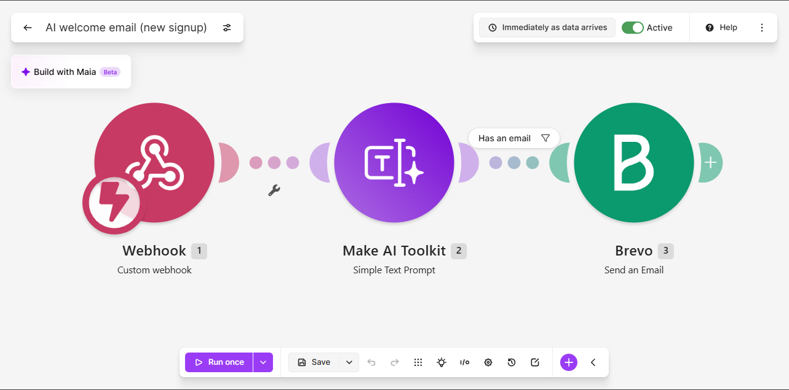
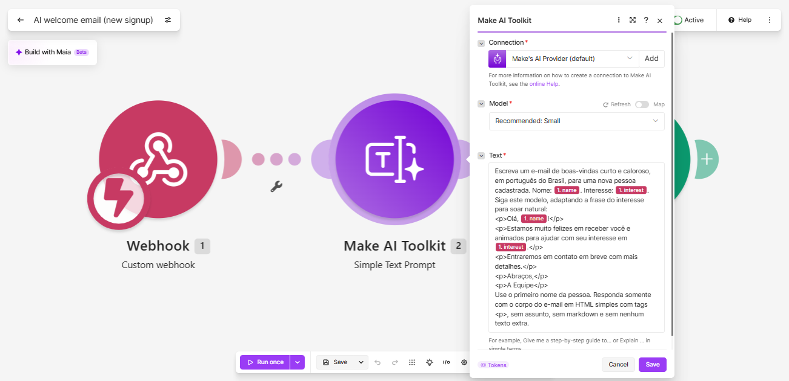
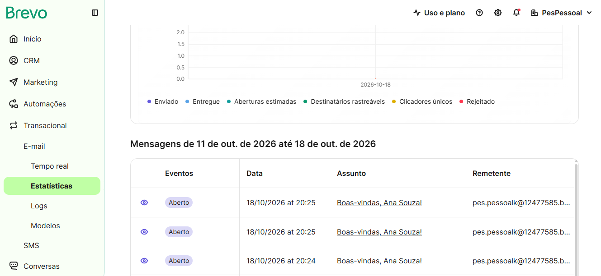
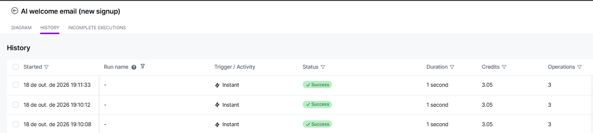
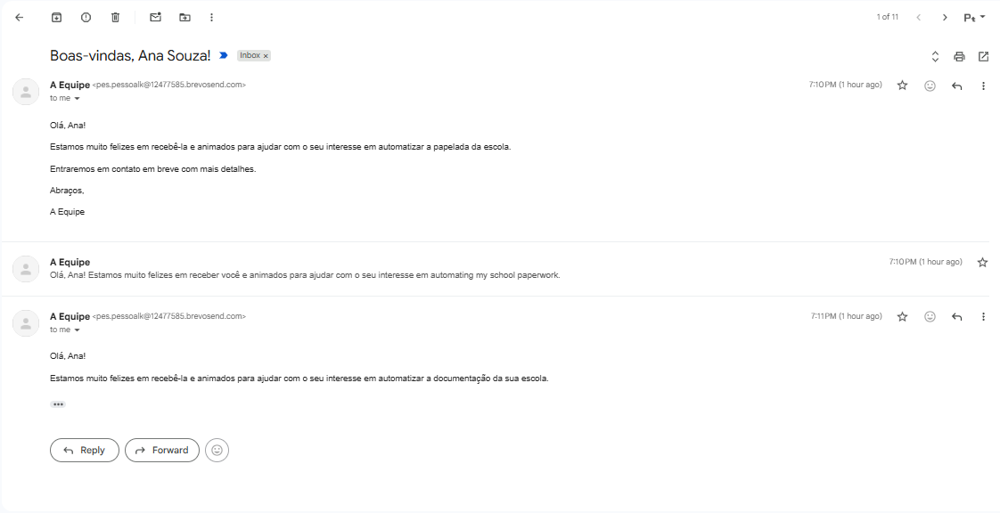

# 🧩 Unidade 3 — Low Code / No Code

**Disciplina:** Tendências em Ciência da Computação
**Semestre:** 2026.2
**Professora:** Kadidja Valéria
**Plataforma utilizada:** [Make](https://www.make.com/) (antigo Integromat)
**Status:** ✅ Protótipo funcional e testado

---

## 1. 📌 Descrição do desafio

O desafio da unidade foi construir uma **solução funcional usando uma plataforma Low Code / No Code**, integrando ferramentas diferentes e aplicando Inteligência Artificial, sem escrever um sistema tradicional do zero.

O problema escolhido foi o seguinte:

> Quando uma pessoa se cadastra em um site ou formulário, ela costuma receber um e-mail de boas-vindas genérico, igual para todo mundo, ou não recebe nada. Escrever um e-mail personalizado para cada cadastro, manualmente, não é viável.

A solução proposta é um **fluxo automático de e-mail de boas-vindas personalizado com IA**: assim que um novo cadastro chega, a IA escreve uma mensagem pensada para aquela pessoa, considerando o nome e o interesse informado, e o e-mail é enviado na hora.

---

## 2. 🛠️ Solução desenvolvida

A automação foi construída no Make como um **cenário** chamado **"AI welcome email (new signup)"**, composto por 3 módulos ligados em sequência:

```text
┌────────────────────┐     ┌────────────────────────┐     ┌────────────────────┐
│ 1. Webhook          │ ──▶ │ 2. Make AI Toolkit      │ ──▶ │ 3. Brevo            │
│ Recebe o cadastro   │     │ Simple Text Prompt      │     │ Envia o e-mail      │
│ (name, email,       │     │ Escreve o e-mail de     │     │ para o novo         │
│  interest)          │     │ boas-vindas com IA      │     │ cadastro            │
└────────────────────┘     └────────────────────────┘     └────────────────────┘
```

### Etapas do fluxo

| Etapa | Módulo no Make | O que faz |
|---|---|---|
| 1 | **Webhooks → Custom webhook** | Fica escutando uma URL. Quando um formulário envia um cadastro com `name`, `email` e `interest`, o cenário é disparado automaticamente. |
| 2 | **Make AI Toolkit → Simple Text Prompt** | Recebe os dados do cadastro e, a partir de um prompt com um modelo de texto, gera um e-mail de boas-vindas curto e personalizado em português. Modelo utilizado: **small** (gpt-5-nano), pela conexão *Make AI Provider*. |
| — | **Filtro "Has an email"** | Entre a IA e o Brevo, só deixa o fluxo seguir se o cadastro tiver um e-mail preenchido, evitando tentativas de envio sem destinatário. |
| 3 | **Brevo → Send an email** | Envia o texto gerado para o e-mail da pessoa cadastrada, com o assunto **"Boas-vindas, {nome}!"** e o remetente **"A Equipe"**. |

### Exemplo de entrada (dados enviados ao webhook)

```json
{
  "name": "Ana Souza",
  "email": "ana@exemplo.com",
  "interest": "automação com IA"
}
```

### Exemplo de saída

A Ana recebe na caixa de entrada um e-mail com o assunto **"Boas-vindas, Ana Souza!"**, escrito pela IA, que cita o interesse dela em automação com IA e dá as boas-vindas de forma pessoal.

### Cenário auxiliar de teste

Também foi criado um segundo cenário, **"Test sender for AI welcome email"**, que envia um cadastro de exemplo para o webhook. Ele simula um formulário real e permite testar o fluxo completo sempre que necessário, sem precisar de um site pronto.

---

## 3. 🖼️ Prints e links

### Links

- Cenário principal: [AI welcome email (new signup)](https://us2.make.com/3202594/scenarios/6683437)
- Cenário de teste: [Test sender for AI welcome email](https://us2.make.com/3202594/scenarios/6683456)

> Os links acima abrem no Make e exigem login na conta do grupo. Por isso, os prints abaixo registram o funcionamento.
>
> A URL do webhook não foi publicada aqui de propósito: como o repositório é público, qualquer pessoa poderia usá-la para disparar e-mails e consumir os créditos da conta.

### Prints

<!-- Salve as imagens na pasta prints/ com os nomes abaixo (ou ajuste os caminhos). -->

**Visão geral do cenário (3 módulos ligados)**



**Configuração do módulo de IA (prompt e modelo)**



**E-mails enviados pelo Brevo (assunto, remetente e status "Aberto")**



**Histórico de execuções com status SUCCESS**



**E-mail recebido na caixa de entrada**



> Os três e-mails da conversa vieram do mesmo cadastro de teste, e cada um tem um texto diferente, porque a IA reescreve a mensagem a cada envio. No segundo, um trecho do interesse ficou em inglês ("automating my school paperwork"), porque o dado de teste foi enviado em inglês e a IA o copiou sem traduzir. Esse comportamento está discutido na análise crítica.

---

## 4. 💡 Justificativa da escolha

**Por que o Make?**

- É uma plataforma **visual**: o fluxo inteiro é montado arrastando e ligando módulos, o que deixa a lógica fácil de entender até para quem não programa.
- Tem **integrações prontas** com milhares de aplicativos, incluindo o Brevo (serviço de e-mail) e um módulo nativo de IA, o que eliminou a necessidade de programar chamadas de API, autenticação e tratamento de respostas.
- Oferece **webhooks** de forma nativa, então qualquer formulário (Google Forms, site próprio, landing page) pode disparar o fluxo.
- Tem **plano gratuito**, suficiente para construir e testar um protótipo acadêmico.
- Faz parte das ferramentas previstas para a Unidade III da disciplina.

**Por que esse problema?**

- É um caso de uso **real e comum** em empresas e projetos: dar boas-vindas a novos usuários.
- Combina os principais temas da unidade em uma só solução: **integração de ferramentas**, **automação** e **uso de IA generativa**.
- Também aplica o que foi estudado na Unidade I, porque a qualidade do e-mail depende diretamente da **engenharia de prompt** usada no módulo de IA.

---

## 5. ⚖️ Análise crítica: vantagens e limitações

### ✅ Vantagens

| Vantagem | Como apareceu no projeto |
|---|---|
| **Velocidade de desenvolvimento** | O protótipo funcional ficou pronto em poucas horas. Em código tradicional, seria preciso montar um servidor, integrar a API de IA e a API de e-mail e hospedar tudo. |
| **Acessível para não programadores** | O fluxo é visual. Qualquer integrante do grupo consegue abrir o cenário e entender o que cada etapa faz. |
| **Integrações prontas** | Brevo e IA foram conectados com poucos cliques, sem lidar com chaves de API no código. |
| **Personalização em escala** | Cada pessoa recebe um e-mail diferente, escrito para ela, sem trabalho manual. |
| **Fácil de testar e monitorar** | O Make guarda o histórico de cada execução, mostrando o que entrou e saiu de cada módulo, o que facilitou encontrar e corrigir erros. |
| **Fácil de evoluir** | Novas etapas (salvar o cadastro numa planilha, avisar no WhatsApp, etc.) podem ser adicionadas ligando novos módulos. |

### ⚠️ Limitações

| Limitação | Como apareceu no projeto |
|---|---|
| **Dependência da plataforma (vendor lock-in)** | O fluxo só existe dentro do Make. Mudar de plataforma significa reconstruir tudo. |
| **Mudanças de versão da própria plataforma** | No primeiro teste, o módulo de IA falhou com o erro *"You are using old version of the app"*, e foi preciso atualizá-lo para o Make AI Toolkit atual e escolher o modelo manualmente no editor. |
| **Custos e limites de uso** | Cada execução consome créditos do Make e da cota do Brevo. Em grande volume, o plano gratuito não seria suficiente. |
| **Respostas da IA não são 100% previsíveis** | A IA pode gerar textos diferentes a cada vez e, em alguns casos, incluir conteúdo indesejado. Foi preciso refinar o prompt porque, em uma versão inicial, trechos que não faziam parte do e-mail estavam indo junto para o texto. Nos testes, a mesma entrada gerou três textos diferentes, e em um deles o interesse ficou em inglês. |
| **Configurações obrigatórias pouco visíveis** | O Brevo exigia um remetente configurado, o que só ficou claro depois de um teste. |
| **Segurança** | A URL do webhook funciona como uma "chave": se for exposta, qualquer um pode disparar e-mails. Seria necessário adicionar validação (por exemplo, um token) para uso real. |
| **Privacidade de dados** | Nome, e-mail e interesse passam por serviços de terceiros (Make, provedor de IA e Brevo), o que exige atenção à LGPD em um uso real. |
| **Limite de personalização** | Regras de negócio muito específicas são mais difíceis de expressar visualmente do que em código. |

---

## 6. 🧠 Reflexão

<!-- Revise este texto com as percepções do grupo. -->

O projeto mostrou na prática a principal promessa do Low Code / No Code: **sair da ideia para uma solução funcionando muito rápido**, combinando ferramentas que já existem em vez de construir tudo do zero. Em poucas horas, um fluxo com webhook, IA generativa e envio de e-mail estava ativo e testado.

Ao mesmo tempo, ficou claro que **"pouco código" não significa "nenhum conhecimento técnico"**. Para fazer a solução funcionar foi preciso entender o que é um webhook, como os dados passam de um módulo para outro, interpretar mensagens de erro no histórico de execuções e refinar o prompt da IA. Os erros encontrados (módulo de IA desatualizado, remetente obrigatório no Brevo, texto da IA com trechos indesejados) foram resolvidos com raciocínio de depuração, igual ao de um projeto com código.

Também foi possível perceber que a IA generativa, dentro de uma automação, precisa de **instruções bem definidas**: o resultado melhorou quando o prompt passou a explicar claramente o papel da IA, o formato esperado e o que ela não deveria incluir. Isso conecta esta unidade com a Engenharia de Prompt estudada na Unidade I.

Por fim, a experiência reforçou que o Low Code é ótimo para **protótipos, automações internas e validação de ideias**, mas uma solução em produção exigiria cuidados extras com segurança, privacidade dos dados, custos e dependência da plataforma.

---

## 7. 👥 Colaboração em grupo

<!-- Preencha com os nomes reais e ajuste as responsabilidades. -->

| Integrante | Responsabilidades |
|---|---|
| Kauã Sousa ([@Kaua1217](https://github.com/Kaua1217)) | _[preencher: ex. montagem do cenário no Make e integração com o Brevo]_ |
| _[Nome do integrante 2]_ | _[preencher: ex. criação e refinamento do prompt da IA]_ |
| _[Nome do integrante 3]_ | _[preencher: ex. testes do fluxo e registro dos prints]_ |
| _[Nome do integrante 4]_ | _[preencher: ex. documentação no GitHub e análise crítica]_ |

**Como o grupo se organizou:** _[preencher: ex. reuniões, divisão de tarefas, ferramentas de comunicação usadas]_

---

## 8. 🚀 Próximos passos possíveis

- Conectar o webhook a um formulário real (Google Forms ou página do projeto).
- Adicionar um filtro com token para que só o formulário oficial consiga disparar o fluxo.
- Salvar cada cadastro em uma planilha ou banco de dados para acompanhamento.
- Tratar erros no cenário, como e-mail inválido, para que uma falha não interrompa o fluxo.
